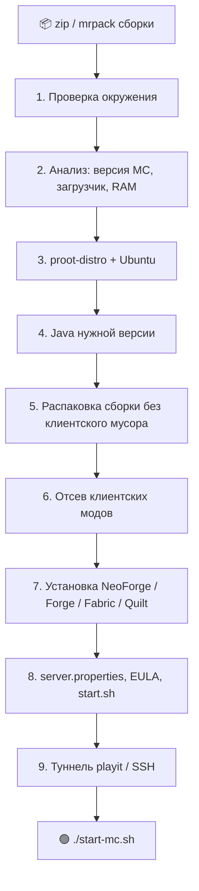

<div align="center">

# 🟩 Prism → Termux Minecraft Server

**Один Python-скрипт, который превращает экспорт сборки из Prism Launcher в готовый модовый Minecraft-сервер прямо на вашем Android-телефоне.**


</div>

---

## ✨ Что умеет

| | |
|---|---|
| 📦 **Разбирает сборку сам** | Читает `mmc-pack.json` из экспорта Prism (или `.mrpack` из Modrinth): версия Minecraft, загрузчик, объём памяти |
| ☕ **Подбирает Java** | 8 / 17 / 21 / 25 под версию игры, ставит внутрь Ubuntu в `proot-distro` |
| 🧩 **Ставит загрузчик** | NeoForge, Forge, Fabric, Quilt или чистый Vanilla — всё скачивается автоматически |
| 🚫 **Убирает клиентские моды** | Определяет их по метаданным и списку имён, переносит в `mods-client-disabled/` (ничего не удаляется) |
| 🩹 **Чинит падения** | `--fix-mods --autofix` читает лог, отключает моды, из-за которых сервер не стартует, и пробует снова |
| 🌍 **Подставляет ваш мир** | `--import-world` из папки или zip, с привязкой инвентаря к нику |
| 🌐 **Туннель для друзей** | playit.gg или собственный VPS по SSH — игра из интернета без белого IP |
| 🏴‍☠️ **Пускает и пиратов** | `online-mode=false` по умолчанию, плюс белый список одним флагом |
| ⚙️ **Настройки сервера** | MOTD, сложность, режим, число игроков и любые другие параметры флагами или вопросами |
| 🔁 **Можно перезапускать** | Готовые шаги пропускаются, всё пишется в `install.log` |

---

## 📋 Требования

- Android-телефон (процессор **arm64** или x86_64) — root **не нужен**
- [Termux](https://f-droid.org/packages/com.termux/) из **F-Droid** или с GitHub (версия из Google Play устарела)
- Интернет и свободное место: от **4–5 ГБ** (дистрибутив ≈ 1 ГБ + Java + сборка + мир)
- Оперативная память: для модовой сборки желательно **4+ ГБ свободно**
- Архив сборки: **Prism Launcher → Instance → Export Instance** (формат Prism `.zip`) или Modrinth `.mrpack`

> ⚠️ CurseForge-манифесты (`manifest.json`) не поддерживаются: в них нет самих модов, только ID.

---

## 🚀 Быстрый старт

**1. Подготовьте Termux**

```bash
pkg update -y && pkg install -y python git
termux-setup-storage        # разрешите доступ к памяти в окне Android
```

**2. Скачайте скрипт**

```bash
git clone https://github.com/ВАШ_ЛОГИН/ИМЯ_РЕПО.git
cd ИМЯ_РЕПО
```

**3. Положите архив сборки в «Загрузки» на телефоне и запустите**

```bash
python install_mc_server.py
```

Скрипт сам найдёт архивы сборок в Загрузках и предложит выбрать. Можно и указать путь явно:

```bash
python install_mc_server.py /sdcard/Download/МояСборка.zip --accept-eula --test-run
```

**4. Запускайте сервер**

```bash
cd ~
./start-mc.sh
```

Первый запуск долгий (5–15 минут на телефоне: загрузка модов и генерация мира). Ждите строку `Done (…s)!`. Остановить сервер — команда `stop` в консоли.

> 📜 Флаг `--accept-eula` означает, что вы принимаете [Minecraft EULA](https://aka.ms/MinecraftEULA). Без него скрипт спросит об этом сам.

---

## 🔧 Как это работает



Сервер живёт в обычной папке Termux `~/mc-server`, а внутрь proot она монтируется как `/server`. Поэтому удаление или переустановка дистрибутива **не затрагивает мир и моды**.

| Версия Minecraft | Java |
|---|---|
| 1.20.5 и новее (включая 1.21.x) | 21 |
| 1.17 – 1.20.4 | 17 |
| 1.16.5 и старше | 8 |
| 26.x (новая схема нумерации) | 25 |

Автоподбор — эвристика; при необходимости задайте версию вручную: `--java 17`.

---

## 🌐 Как подключиться

Все игроки должны играть на **той же сборке**: та же версия Minecraft, тот же загрузчик и те же моды. Проще всего, если друг импортирует в Prism тот же архив.

В игре: **Сетевая игра → Прямое подключение →** адрес сервера.

| Где игрок | Адрес |
|---|---|
| На том же телефоне | `localhost` |
| В той же Wi-Fi сети | `IP-телефона` (например `192.168.1.57`) |
| В интернете | адрес вашего туннеля (см. ниже) |

### Туннель

Настраивается при установке или позже командой:

```bash
python install_mc_server.py --setup-tunnel
```

**Вариант 1 — [playit.gg](https://playit.gg)** (бесплатно). Один раз нужно привязать агент к аккаунту: скрипт запустит демон и `playit-cli`, вы откроете выданную ссылку (или введёте код на сайте), войдёте и создадите туннель *Minecraft Java* на порт `25565`. Дальше туннель стартует сам вместе с сервером. Управление: `./playit.sh`.

**Вариант 2 — свой VPS по SSH** (платно, самый надёжный). На VPS один раз от root:

```bash
echo "GatewayPorts clientspecified" >> /etc/ssh/sshd_config
systemctl restart ssh
ufw allow 25565/tcp
```

Затем на телефоне:

```bash
python install_mc_server.py --setup-tunnel --tunnel ssh --ssh-target user@адрес-VPS
```

Скрипт создаст SSH-ключ, скопирует его на VPS и настроит автоматическое переподключение. Адрес для друзей: `адрес-VPS:25565`.

> ℹ️ **Доступность из разных стран зависит от провайдера игрока.** По сообщениям пользователей, некоторые провайдеры (в частности, мобильные операторы в России) ограничивают playit.gg и ряд зарубежных хостингов. Универсального туннеля нет: если друг не может подключиться, попробуйте другой вариант — например, VPS ближе к нему.

---

## 🏴‍☠️ Пиратские клиенты и безопасность

По умолчанию сервер работает с `online-mode=false`: **он пускает и лицензионные, и нелицензионные клиенты**. Это значит, что сервер не проверяет аккаунты, и любой, кто знает адрес, может зайти под любым ником.

Рекомендации:

- Включите белый список: `--whitelist Вася,Петя` (скрипт сам запишет `whitelist.json` с правильными offline-UUID).
- Не выдавайте `op` по нику без белого списка.
- Хотите только лицензионные аккаунты — `--online-mode true`.

---

## ⚙️ Настройки сервера

Задайте при установке или измените позже у готового сервера:

```bash
python install_mc_server.py --configure                      # интерактивные вопросы
python install_mc_server.py --configure --max-players 8 --difficulty hard --motd "Наш сервер"
python install_mc_server.py --configure --set enable-command-block=true
```

| Флаг | Что меняет |
|---|---|
| `--motd` | Описание в списке серверов (кириллица и цветовые коды поддерживаются) |
| `--max-players` | Максимум игроков |
| `--difficulty` | `peaceful` / `easy` / `normal` / `hard` |
| `--gamemode` | `survival` / `creative` / `adventure` / `spectator` |
| `--view-distance` | Дальность прорисовки (по умолчанию у скрипта 8) |
| `--simulation-distance` | Дальность симуляции (по умолчанию 6) |
| `--pvp` | `true` / `false` |
| `--allow-flight` | Не кикать за полёт (нужно некоторым модам) |
| `--spawn-protection` | Радиус защиты спавна (`0` — выключить) |
| `--level-seed` | Сид нового мира (на готовый мир не влияет) |
| `--level-name` | Имя папки мира |
| `--set КЛЮЧ=ЗНАЧЕНИЕ` | Любая другая настройка `server.properties`, можно повторять |
| `--whitelist`, `--online-mode`, `--port` | Доступ и порт |

Изменения применяются при следующем запуске сервера.

---

## 🌍 Свой мир

Мир должен подходить к сборке (та же версия Minecraft и те же моды). Остановите сервер и выполните:

```bash
python install_mc_server.py --import-world /sdcard/Download/МойМир.zip
```

Можно указать папку мира (внутри должен быть `level.dat`) или zip. Прежний мир сохраняется как `world.backup-ДАТА`.

**Инвентарь и прогресс игрока** хранятся по UUID. Если в мире вы играли не под тем ником, под которым зайдёте на сервер, привяжите данные к нику:

```bash
python install_mc_server.py --import-world МойМир.zip --world-player ВашНик
```

Если в мире сохранено несколько игроков, скрипт покажет список, и нужного можно выбрать через `--world-old-uuid`.

---

## 🩹 Сервер падает при запуске

Чаще всего виноваты **клиентские моды** (миникарты, плащи, интерфейсные), которые не умеют работать на сервере. В логе это выглядит как `has failed to load correctly` или `invalid dist DEDICATED_SERVER`.

```bash
python install_mc_server.py --fix-mods              # найти и отключить упавшие моды по логу
python install_mc_server.py --fix-mods --autofix    # то же по кругу: запуск → падение → отключение → запуск
```

Отключённые моды лежат в `~/mc-server/mods-client-disabled/`, вернуть любой можно обычным `mv`.

> ⚠️ Скрипт отключает **любой** мод, который не загрузился. Обычно это клиентский мод, но так же отключится мод с другой проблемой (например, без зависимости). Всё отключённое показывается в выводе.

---

## 📖 Все команды

| Команда | Назначение |
|---|---|
| `python install_mc_server.py [архив]` | Полная установка |
| `--accept-eula` | Принять Minecraft EULA без вопроса |
| `--test-run` | После установки запустить сервер и проверить, что он стартует |
| `--ram 4G` | Память под сервер (по умолчанию считается сама) |
| `--clean` | Удалить старые `mods`/`config` перед установкой (мир не трогается) |
| `--keep-client-mods` | Не отсеивать клиентские моды |
| `--dir ПУТЬ` | Папка сервера (по умолчанию `~/mc-server`) |
| `--distro ИМЯ` | Дистрибутив proot-distro (по умолчанию `ubuntu`) |
| `--java N` | Принудительная версия Java |
| `--tunnel none\|playit\|ssh` | Тип туннеля при установке |
| `--setup-tunnel` | Только настроить или сменить туннель |
| `--configure` | Изменить настройки установленного сервера |
| `--import-world ПУТЬ` | Подставить готовый мир |
| `--fix-mods` / `--autofix` | Отключить упавшие моды / делать это по кругу |
| `-y`, `--yes` | Отвечать «да» на вопросы |
| `--help` | Полная справка |

---

## 📁 Что где лежит

```
~/start-mc.sh                  запуск сервера из Termux
~/playit.sh                    управление playit (если выбран этот туннель)
~/mc-server/                   папка сервера (внутри proot — /server)
├── mods/  config/  ...        содержимое сборки
├── mods-client-disabled/      отключённые клиентские моды
├── world/                     мир
├── server.properties          настройки
├── start.sh                   запуск внутри proot (Java, память, флаги)
├── install.log                лог установки — прикладывайте к обращениям о проблемах
└── .tunnel/                   файлы туннеля (адрес — в address.txt)
```

---

## ❓ Частые вопросы

<details>
<summary><b>Файл не найден в /sdcard/…</b></summary>

Termux не имеет доступа к памяти телефона. Выполните `termux-setup-storage` и разрешите доступ в окне Android.
</details>

<details>
<summary><b>Сервер вылетает с OutOfMemory или Android убивает Termux</b></summary>

Увеличьте память (`--ram 4G` при установке или правка `-Xmx` в `~/mc-server/start.sh`), закройте другие приложения, отключите оптимизацию батареи для Termux и держите телефон на зарядке. На Android 12+ система может останавливать фоновые процессы Termux. Скрипт запускает `termux-wake-lock`, но это не всегда спасает.
</details>

<details>
<summary><b>Не нашёлся пакет openjdk-N</b></summary>

В выбранном дистрибутиве нет нужной Java. Используйте `--distro ubuntu` или задайте другую версию через `--java`.
</details>

<details>
<summary><b>Друг не может подключиться через туннель</b></summary>

Проверьте, что у вас та же сборка и версия, что сервер дошёл до `Done`, и что туннель запущен (`tmux attach -t mc-tunnel`). Если всё в порядке, причина часто в провайдере игрока: попробуйте другой тип туннеля.
</details>

<details>
<summary><b>Зашёл в свой мир, а инвентарь пустой</b></summary>

Данные игрока привязаны к UUID, а у ника на сервере он другой. Используйте `--import-world … --world-player ВашНик`.
</details>

---

## 🧪 Статус тестирования

Скрипт написан для личного использования и выложен «как есть».

| Что | Статус |
|---|---|
| Prism-экспорт, NeoForge 1.21.1: установка, установка загрузчика, привязка playit | ✅ проверено на реальном телефоне |
| Полный запуск до `Done` и подключение игроков через туннель | ⏳ подтвердить и обновить эту строку перед публикацией |
| Forge, Fabric, Quilt, Vanilla, `.mrpack` | 🔶 реализовано, на устройстве не проверялось |
| SSH-туннель, `--import-world`, `--configure`, `--fix-mods --autofix` | 🔶 проверено на тестовых данных, на устройстве не проверялось |

Нашли ошибку? Откройте issue и приложите вывод скрипта и `~/mc-server/install.log`.

---

## ⚖️ Дисклеймер

Проект не связан с Mojang, Microsoft, Prism Launcher, NeoForged, Fabric, QuiltMC и playit.gg. Minecraft — торговая марка Mojang Synergies AB. Принимая EULA и открывая сервер для других игроков, вы сами отвечаете за соблюдение правил Minecraft, лицензий используемых модов и законов вашей страны.

## 📄 Лицензия

См. файл [LICENSE](LICENSE).
